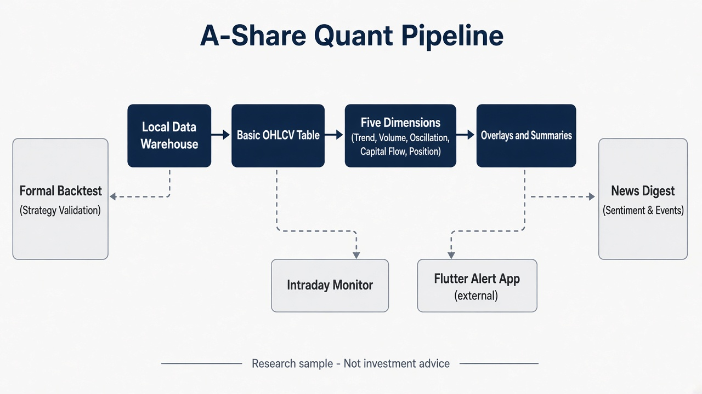
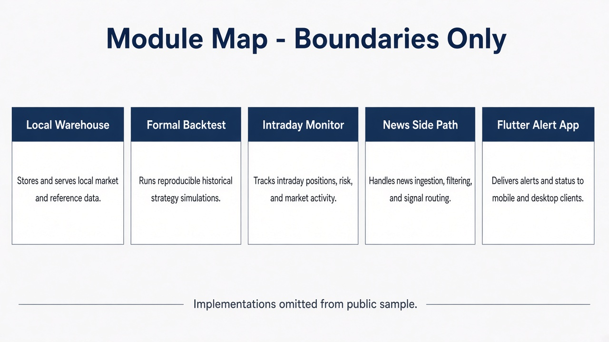
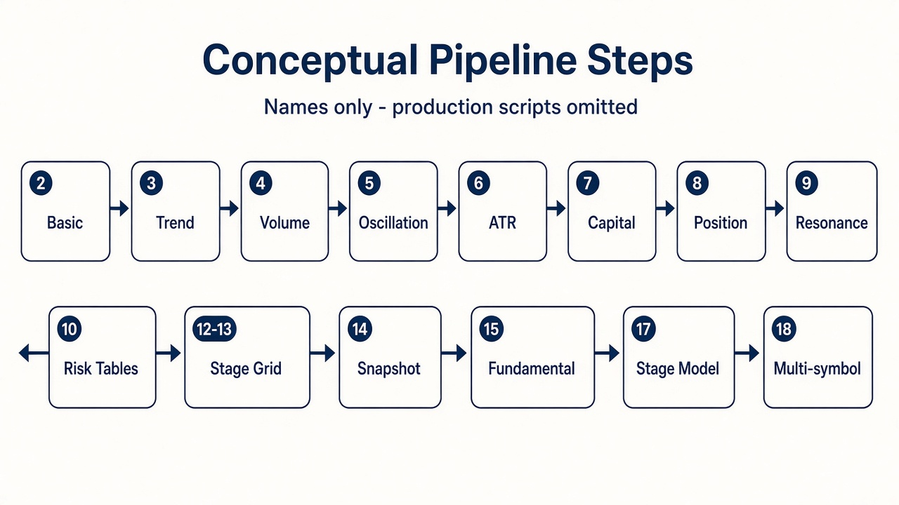
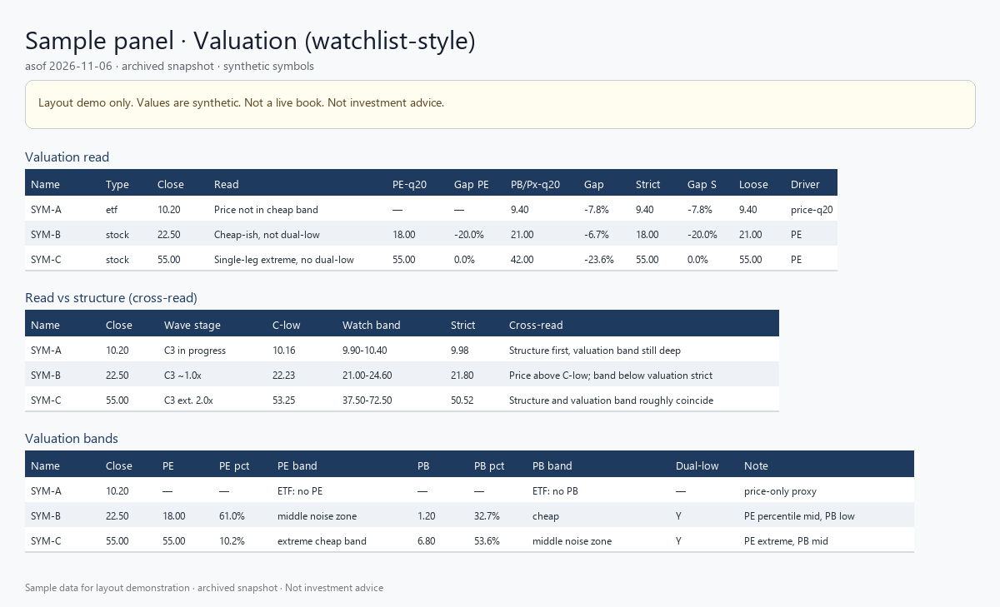
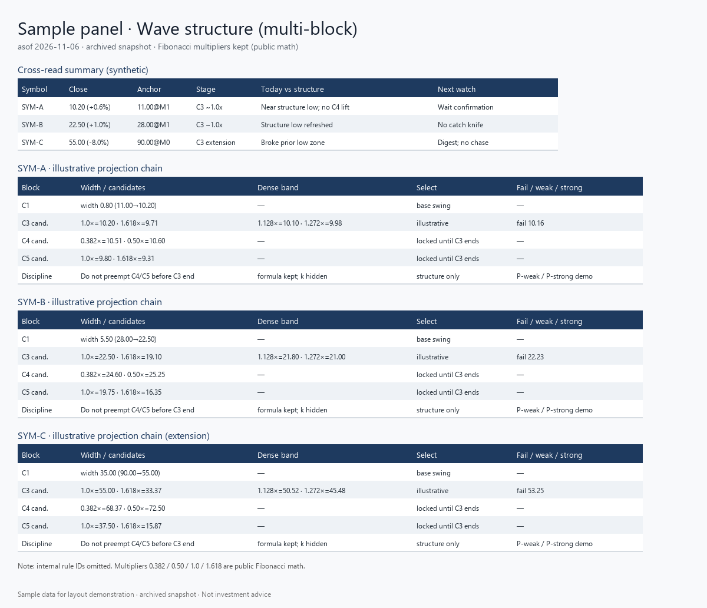
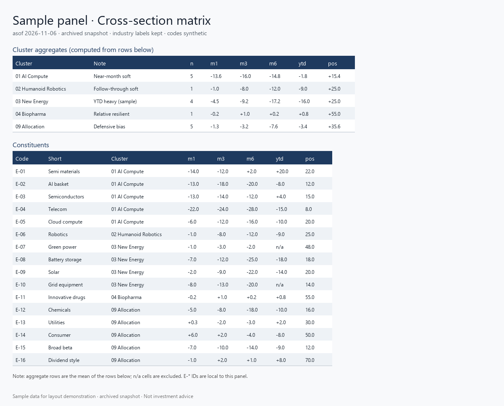
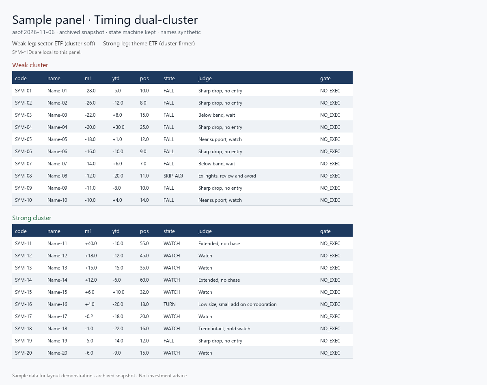
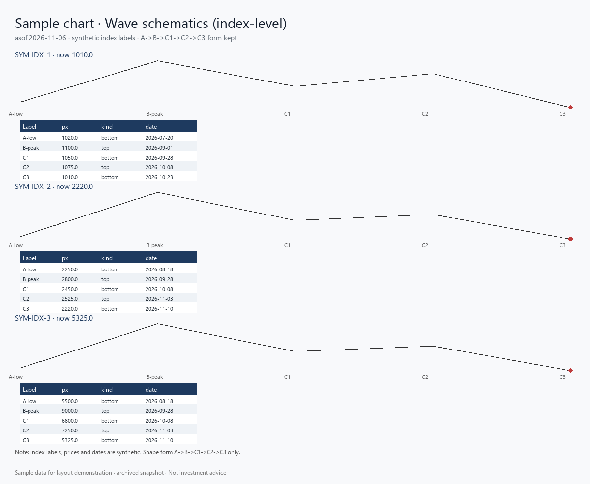
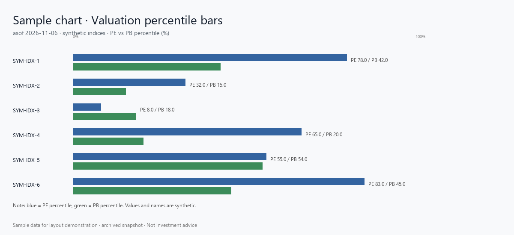

# A-Share Quant Pipeline

Hi, I'm Samye — a quantitative research / Python developer. This repo is a **public architecture sample** of my A-share **technical + fundamental** research pipeline.

**All Rights Reserved** — viewing does not grant commercial reuse rights.  
**Not investment advice.** Not an official product of East Money, any exchange, or any broker.

It shows how I structure a rule-driven daily workflow (indicators → overlays → batch orchestration → warehouse quality gates). It is **not** a runnable clone of the full private course workspace.

**Related shipped app sample:** [stock-alert-assistant](https://github.com/samyezg/stock-alert-assistant) (Flutter Dart core for A-share watchlist alerts; native projects omitted there).

## Repo status

Portfolio / architecture sample. Documentation and sample panels are maintained; this repository is **not** a product release channel and does not ship production runners or credentials.

## Scope

| | |
|:---|:---|
| **Included** | Architecture notes, module map, illustrative photos, synthetic sample panels, example configs, intentional pipeline stubs, tiny toy MA demo |
| **Not included** | Full production step scripts (`1`–`18`), batch/pipeline runners, SQLite warehouses, realtime/news runtimes, credentials, Excel/Parquet outputs |
| **Flutter alert app** | Published separately — see link above; **not** duplicated here |
| **API keys** | Never shipped; production uses local secure config only |

## What this system demonstrates

- **Rule-driven daily pipeline** — trend / volume / oscillation / capital-flow / position dimensions, plus fundamental overlays (concept level)
- **Batch orchestration concept** — ordered steps, shared config pointers, multi-symbol runs
- **Local warehouse + quality-gate idea** — ingest completeness checks before research use
- **Research module map** — formal backtest, valuation/ETF studies, intraday/news side paths as **boundaries only**
- **Engineering discipline** — examples vs secrets, stubs that refuse to pretend they are production

## Gallery

Architecture & pipeline (illustrative):







Synthetic research panels (layout demonstration only — symbols and values are fabricated):









Synthetic charts (form demonstrations — symbols and values are fabricated):





## Layout

```
.
├── ARCHITECTURE.md          # English architecture summary
├── LICENSE                  # All Rights Reserved
├── requirements.sample.txt  # Illustrative dependencies
├── config/
│   ├── batch_config.example.json
│   └── data_source.example.json
├── docs/
│   ├── module-map.md
│   └── photos/
│       ├── architecture/    # system + module diagrams
│       ├── pipeline/        # conceptual step strip
│       ├── panels/          # synthetic sample panels (4)
│       └── charts/          # synthetic schematics (2)
├── scripts/
│   ├── render_panels_sample.py   # regenerate panels/
│   └── render_charts_sample.py   # regenerate charts/
└── skeleton/
    ├── README.md
    ├── pipeline_overview.md
    ├── samples/
    │   └── toy_ohlcv.csv
    └── stubs/
        ├── pipeline_runner.py
        ├── step_*.py
        ├── warehouse_gate.py
        └── toy_ma.py
```

## Skeleton notes

- Step stubs raise `NotImplementedError` on purpose.
- `toy_ma.py` is a **teaching** moving-average on fake CSV — **not** the production indicator engine.
- Example JSON uses placeholder symbols and paths only.

## Disclaimer

Securities research involves risk. This repository is an architecture / portfolio sample, not a trading system distribution and not a recommendation to buy or sell any security.

## License

See [`LICENSE`](./LICENSE) (**All Rights Reserved**).

Copyright (c) 2026 Ye Zhiguo (叶志国). Project: A-Share Quant Pipeline.
